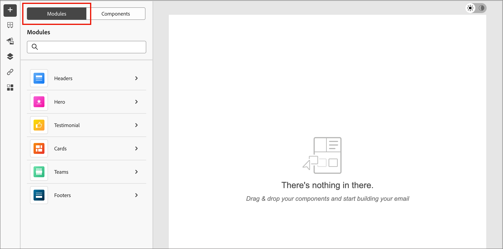

# コンテンツモジュール

[!DNL Adobe Marketo Optimizer]のモジュールを使用して、用意されたレイアウトからコンテンツを組み立てます。 各モジュールは、[構造](./structure-components.md)と[ コンテンツコンポーネント ](./content-components.md)を、独自のテキスト、画像、リンクに置き換えるデフォルトコンテンツと組み合わせています。

個々のコンテンツコンポーネントとは異なり、モジュールはヘッダー、バナー、カード、フッターなどの包括的なセクションを提供します。 カンバスにモジュールを追加し、空のスペースから各セクションを構築するのではなく、そのコンポーネントをカスタマイズします。

モジュールは、[ ビジュアルフラグメント ](./fragments.md)とは異なります。 モジュールは、デザインするコンテンツの一部です。 ビジュアルフラグメントとは、電子メールやメールテンプレートで再利用できる、保存されたコンテンツアセットのことです。

## 「モジュール」タブ

ビジュアルデザインスペースの「**[!UICONTROL モジュール]**」タブを、次のいずれかのコンテンツタイプに使用します。

* 電子メール - [_電子メールコンテンツオーサリング_](./email-authoring.md)&#x200B;を参照してください。
* ランディングページ - [_ランディングページデザイン_](./landing-page-design.md)&#x200B;を参照してください。
* ビジュアルフラグメント - [_フラグメントオーサリング_](./fragment-authoring.md)&#x200B;を参照してください。
* メールテンプレート - [_メールテンプレートの作成_](./templates-create.md#build-new)&#x200B;を参照してください。

ビジュアルデザインキャンバスの横に表示される{width="600" zoomable="yes"}

## モジュールのカテゴリ

カテゴリを展開してレイアウトを選択します。 これらのレイアウトでは、1列、2列、3列など、セクションの内容の配置が異なります。

| カテゴリ | 用途 |
| --- | --- |
| [!UICONTROL ヘッダー] | ロゴ、ナビゲーションリンク、紹介テキストを使用して、コンテンツを紹介します。 |
| [!UICONTROL ヒーロー] | バナーセクションで、告知やプロモーションを強調。 |
| [!UICONTROL お客様の声] | スタイル設定されたセクションに顧客の見積もりを表示する。 |
| [!UICONTROL カード] | 商品、記事、その他のコンテンツ項目をグリッドに配置します。 |
| [!UICONTROL チーム] | チームのメンバー、作成者、講演者に、写真、名前、役割を紹介します。 |
| [!UICONTROL フッター] | ナビゲーションリンク、ソーシャルリンク、法的なテキストを使用して、コンテンツを完成させます。 |

## モジュールの追加とカスタマイズ

作成するセクションに一致するモジュールから開始し、そのコンテンツとスタイルを調整します。 デフォルトのリンクとテキストを、自社のチャネルに適したコンテンツに置き換えます。

>[!NOTE]
>
>マーケティングメールの場合は、メールを公開する前に、オプトアウトリンクと[ メールアラート ](../marketing/email-channel.md#alerts)を確認してください。

1. 電子メール、ランディングページ、ビジュアルフラグメント、メールテンプレートをビジュアルデザイン画面で開きます。

   キャンバスの左側には、デフォルトで「**[!UICONTROL モジュール]**」タブが表示されます。

1. 使用可能なレイアウトを確認するには、カテゴリを展開します。

   検索フィールドを使用して、名前でモジュールを検索することもできます。

1. モジュールをカンバスにドラッグします。

   {width="600" zoomable="yes"}

1. モジュール内の要素を確認します。

   各モジュールには、編集可能なデフォルトコンテンツが含まれています。 キャンバスの左側にある&#x200B;_ナビゲーションツリー_ アイコン（）をクリックして、モジュール内の構造と要素を表示します。

   {width="600" zoomable="yes"}

1. モジュール内の要素を選択してカスタマイズします。

   デフォルトテキストを置き換え、アセットから画像を選択し、コンテンツのリンクを更新できます。

   選択したコンポーネントを調整するには、**[!UICONTROL 設定]** タブと&#x200B;**[!UICONTROL スタイル]** タブを使用します。

   スタイルのオプションが表示されたモジュールで{width="600" zoomable="yes"}

1. 別の要素を追加するには、「**[!UICONTROL コンポーネント]**」タブを選択し、[ コンテンツコンポーネント ](./content-components.md)をモジュールにドラッグします。

   モジュール構造にコンポーネントを追加すると、デフォルトでモジュールのスタイル設定が継承されます。 必要に応じてスタイルを調整します。

   {width="800" zoomable="yes"}

1. **[!UICONTROL 保存]**&#x200B;を選択して、変更を保存します。

>[!NOTE]
>
>メールコンテンツにブランドテーマが適用されると、モジュールはそのスタイルを継承します。 [ ゼロから電子メールをデザイン ](./email-authoring.md#design-from-scratch)する場合は、スタイル設定モードを選択します。

## カスタマイズしたモジュールコンテンツの再利用

再利用可能なモジュールコンテンツを作成するには、[ ビジュアルフラグメントを作成し](./fragments.md#create-fragments)、フラグメントデザイン空間でモジュールを追加してカスタマイズします。 フラグメントを保存して公開し、メールやメールテンプレートで利用できるようにします。

次に、[ フラグメント ](./fragments.md#add-to-content)を他の電子メールまたは電子メールテンプレートに挿入します。
