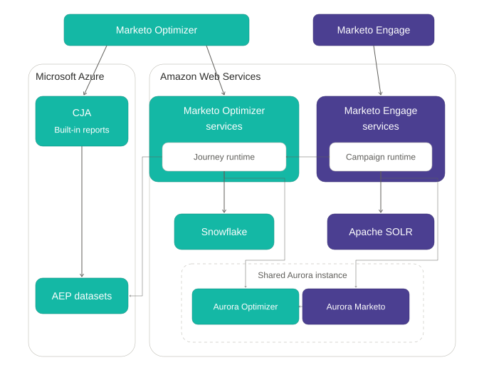

# データアーキテクチャ

[!DNL Adobe Marketo Optimizer]は[!DNL Adobe Marketo Engage]と統合して、B2B リードの包括的なビューを提供します。 双方向の信頼できる同期により、両製品の連携が維持され、人物、企業、カスタムオブジェクト、アクティビティに関する単一のビューを共有できます。 [!DNL Marketo Engage]は引き続き人物データの信頼できるソースです。 各[!DNL Marketo Optimizer] インスタンスは、1つの[!DNL Marketo Engage] インスタンスとペアになっています。

## データ基盤 {#data-foundation}

[!DNL Marketo Optimizer]と[!DNL Marketo Engage]は、下流の分析のフィード中に同期を維持する共通のデータ基盤を共有しています。

大まかなレベルでは：

* **[!DNL Marketo Engage]**&#x200B;は、リードおよびカスタムオブジェクトデータの決定的なソースであり、キャプチャ時のデータの整合性を確保します。
* **データブローカー層**&#x200B;は、2つの製品間でのデータの移動を調整します。 共有データとレプリケートされたデータを、使用可能なデータベースに集約します。 交換全体は、1つのAurora MySQL クラスター内で実行されます。
* **[!DNL Marketo Optimizer]**&#x200B;は、実行するジャーニーアクティビティの信頼できるソースです。

## エンティティの同期 {#entity-sync}

各エンティティタイプは、データの整合性を最も効果的に保護する方向と速度で同期します。

| [!DNL Marketo Engage] エンティティ | 方向を同期 | 遅延 |
| --- | --- | --- |
| リード | 双方向 | 1秒未満 |
| 会社 | 双方向 | 1秒未満 |
| カスタムオブジェクト | 一方向 | 5秒未満 |
| アクティビティ | 一方向 | 5秒未満 |
| プログラムメンバーシップ | 同期されていません | 該当なし |
| アセット | 同期されていません | 該当なし |

同期は、次の2つの方法で機能します。

* **リード、会社、および標準オブジェクト：** [!DNL Marketo Engage]が個人テーブルを所有し、読み取りと書き込みのデータベースビューを通じて共有します。 一方の製品の更新は、もう一方の製品にすぐに表示され、重複したコピーは作成されません。
* **カスタムオブジェクト：** データは[!DNL Marketo Engage]から数秒以内にレプリケートされます。 [!DNL Marketo Engage]のスキーマ更新は、アクティブなジャーニーにすぐに利用できます。

[!DNL Marketo Engage]と[!DNL Marketo Optimizer]は、プログラムメンバーシップまたはアセットを同期しません。 この除外により、システムのスピードと統合性が維持されます。

>[!NOTE]
>
>データは[!DNL Marketo Optimizer]に同期され、データ ウェアハウスに最終的に一貫性があります。 タイミングは、基礎となる変更データの取得、バッチ、またはストリームのメカニズムによって異なります。

ほぼリアルタイムに近いデザインにより、ジャーニーとレポートの最新データを入手できます。 優先順位の高いリードにはすばやくフォローアップできます。 製品の使用状況や意図などのB2B コンテキストデータを、変化に応じたジャーニー決定に使用することも可能です。

## 活動データフロー {#activity-flow}

アクティビティは、他のエンティティとは別のパスに従います。 各アクティビティは、次の5つのステージを通過します。

1. **プライマリキャプチャ：** [!DNL Marketo Engage]は、アクティビティを共有データベースに書き込み、Apache SOLRでインデックスを作成して、[!DNL Marketo Engage]内で迅速に検索します。
1. **製品間の認知度：** [!DNL Marketo Engage]がアクティビティをアクティビティパイプラインに公開するため、[!DNL Marketo Optimizer]はすぐに受け取ります。
1. **分析変換：** ジャーニーランタイムは、アクティビティを処理してSnowflakeに書き込み、運用データを分析対応データに変換します。 これまでのステージはすべてAmazon Web Services（AWS）で実行されます。
1. **ダウンストリームの宛先：** [!DNL Marketo Optimizer]は、アクティビティを[!DNL Adobe Experience Platform]個のデータセットにレプリケートします。
1. **レポート：** データセット フィードには[!DNL Adobe Customer Journey Analytics]件のレポートが埋め込まれています。 [!DNL Customer Journey Analytics]は、Microsoft AzureまたはAWSでホストできます。 [!DNL Query Service]を含むデータセットをクエリすることもできます。 [Experience Platform データセット &#x200B;](./reports/aep-datasets.md)を参照してください。

ジャーニーとイベントオーディエンスは、[!DNL Marketo Optimizer] アクティビティと[!DNL Marketo Engage] アクティビティのサブセットの両方を使用できます。 両方のセットを同じように使用します。 [!DNL Marketo Optimizer]件のアクティビティが[!DNL Marketo Engage]に送り返されません。

フォーム入力、web訪問、電子メールのエンゲージメントなどのアクティビティを使用して、トリガー、フィルター、ブランチ担当者のジャーニーを作成できます。

* [イベントトリガーの「リッスン」ノードのイベントノード](./marketing/listen-for-event-nodes.md#event-triggers)
* [イベントノードの「リッスン」のイベントフィルター](./marketing/listen-for-event-nodes.md#event-filters)
* [分割パスノードの一致する人物フィルター](./marketing/split-merge-paths-nodes.md#matched-person-filters)
* [イベントベースのオーディエンス](./audiences/event-based-audiences.md)

## データの分離とサンドボックス {#data-isolation}

[!DNL Marketo Engage]、[!DNL Marketo Optimizer]および[!DNL Experience Platform]は、このアーキテクチャの一部として顧客データを共有しています。 Adobeは、[!DNL Experience Platform]個のサンドボックスを使用して、データを他のテナントから論理的に分離します。 データは安全で暗号化されたチャネルを移動します。 Adobeでは、業界標準の暗号化とアクセス制御を使用してAdobe Managed Servicesに保存されます。

各[!DNL Marketo Optimizer] インスタンスには、[!DNL Adobe Admin Console]に専用の製品カードと専用サンドボックスがあります。 Adobeは両方を自動的にプロビジョニングするので、サンドボックスを作成する必要はありません。 サンドボックス名では、パターン `mktoaep<prefix>`が使用されます。接頭辞は[!DNL Marketo Engage]接頭辞です。 [!DNL Marketo Optimizer]を複数の[!DNL Marketo Engage] インスタンスで使用する場合、各インスタンスには独自の製品カードとサンドボックスがあります。

[!DNL Marketo Optimizer]は、組織に他のサンドボックスがある場合でも、このサンドボックスでのみ使用できます。

プロビジョニングでは、サンドボックスアクセスは割り当てられません。 通常、役割はデフォルトの`prod` サンドボックスにアクセスできますが、[!DNL Marketo Optimizer]はそれを使用しません。 [!DNL Experience Platform]の役割ごとに専用サンドボックスを明示的に割り当てるか、ユーザーが[!DNL Marketo Optimizer]で作業できない。 ユーザーグループを使用して、役割の設定を繰り返さずにユーザーを追加および削除します。 完全な手順については、[&#x200B; ユーザーアクセスと権限](./start/user-management.md)を参照してください。

[!DNL Marketo Optimizer]は、バックグラウンドで[!DNL Experience Platform] サービスも使用しています。 これには、スキーマレジストリ、有料メディアの書き出し先、アクセス制御、および[!DNL Customer Journey Analytics]が含まれます。 スキーマや名前空間は設定しません。 [!DNL Marketo Optimizer]は、[!DNL Real-Time Customer Data Platform]、リアルタイム顧客プロファイル、またはセグメント化を必要としません。

>[!WARNING]
>
>専用の[!DNL Marketo Optimizer] サンドボックスは削除しないでください。 削除は永続的であり、元に戻すことはできません。 回復するために[!DNL Marketo Optimizer]を再プロビジョニングします。
