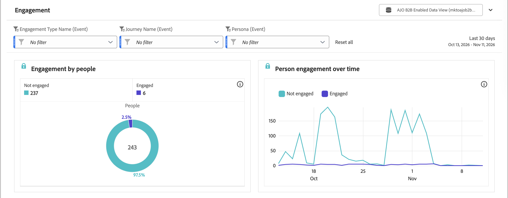

# エンゲージメントレポート

[!UICONTROL  エンゲージメント ] レポートを使用して、人物によるエンゲージメントや時間の経過に伴うエンゲージメントの傾向など、人物がマーケティングプログラムとどのようにエンゲージしているかを確認します。

レポートを表示するには（_T） :_

1. 左側のナビゲーションで、**[!UICONTROL レポート]**&#x200B;を選択します。
1. _リスト_ アイコン （）をクリックし、_[!UICONTROL 目次]_ パネルで&#x200B;**[!UICONTROL エンゲージメント]**&#x200B;を選択します。

## レポートタイル {#report-tiles}

[!UICONTROL  エンゲージメント ] レポートには2つのタイルが含まれています。

* **[!UICONTROL 人物によるエンゲージメント]** - インスタンス内の人物のエンゲージメントを表示します。
* **[!UICONTROL 人物のエンゲージメント時間の経過]** – 人物のエンゲージメントが時間の経過とともにどのように変化するかを示します。

{width="700" zoomable="yes"}

各レポートタイルの日付範囲](./reports-overview.md#change-the-date-range)を[変更できます。

レポートの上部にある「**[!UICONTROL 共有]**」を選択して、すべてのレポートデータの書き出しをダウンロードまたはスケジュールします。 レポートの概要の「[_レポートの書き出し_](./reports-overview.md#export-a-report)」を参照してください。

## フィルター {#filters}

レポートの上部にあるフィルターを使用して、エンゲージメントデータを絞り込みます。 フィルターリストを開き、含める値を選択します。

* **[!UICONTROL エンゲージメントタイプ名（イベント）]** – 電子メールなどのエンゲージメントのタイプでフィルタリングします。 デフォルトは[!UICONTROL  フィルターなし]。
* **[!UICONTROL ジャーニー名（イベント）]** - エンゲージメントに関連付けられているジャーニーでフィルタリングします。 デフォルトは[!UICONTROL  フィルターなし]。
* **[!UICONTROL ペルソナ （イベント）]** - エンゲージメントに関連付けられている[派生ペルソナ ](../audiences/personas.md#filter-by-derived-persona)でフィルタリングします。 デフォルトは[!UICONTROL  フィルターなし]。

{width="500" zoomable="yes"}

**[!UICONTROL すべてをリセット]**&#x200B;を選択して、すべてのフィルターをクリアし、デフォルトのビューに戻ります。
