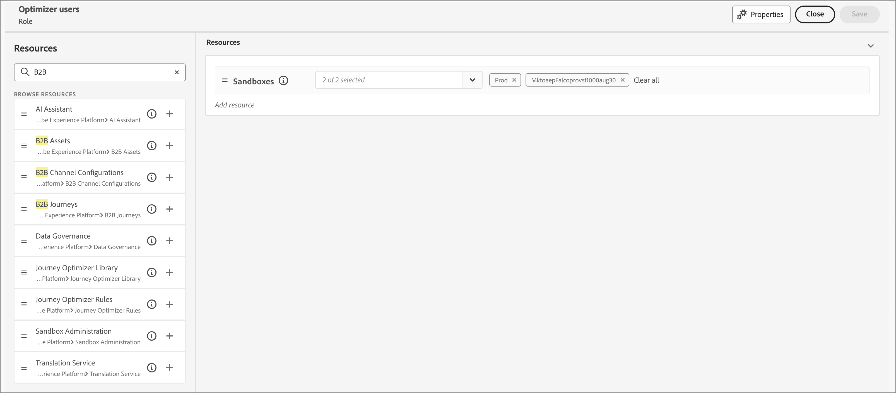
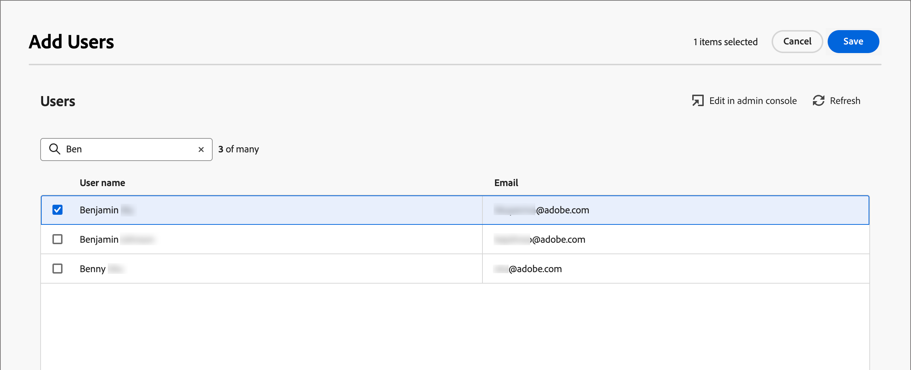

# ユーザーのアクセスと権限

プロビジョニングが完了し、サンドボックスがバインドされたら、次の手順を実行して、チームとユーザーに[!DNL Marketo Optimizer] アクセスを提供します。

1. [Admin Consoleで [!DNL Marketo Optimizer] 製品プロファイル ](#create-profile)を作成します（1回限り/初期設定のみ）。
1. Admin Consoleで [ ユーザーグループを追加 ](#add-user-group) します。
1. [製品プロファイル ](#assign-profile)をAdmin Consoleのユーザーグループに割り当てます。
1. [Admin Consoleの新しいグループ ](#add-users)にユーザーを追加します。
1. [ ビルトインロールを編集](#edit-role-permissions)または[製品の権限と必要な[!DNL Marketo Optimizer] サンドボックスをExperience Platformで使用して、カスタムロール ](#create-a-custom-role)を作成します。
1. [Adobe Experience Platformのロールにユーザー](#add-users-to-a-role)または[ グループ ](#add-user-groups-to-a-role)を追加します。

管理者、すべてのアクセス権を持つユーザー、および読み取り専用ユーザーに推奨されるユーザーグループと役割を設定するには、[推奨ユーザータイプ ](./permissions-reference.md#suggested-user-types)および[推奨ユーザータイプのユーザーグループと役割を作成](#create-suggested-roles)を参照してください。

## 製品プロファイルの設定 {#config-profile}

管理者は、Adobe製品のライセンスとユーザーを一元的に管理する[!DNL Adobe Admin Console]でこれらのタスクを実行できます。 Admin Console では、様々な個別のソリューション内ではなく、1 か所でユーザーを作成および管理できます。 その機能と機能について詳しくは、[Admin Consoleの概要](https://helpx.adobe.com/business/enterprise/deploy-apps-updates.html) ページを参照してください。

### Admin Console へのアクセス {#admin-console}

Admin Consoleを使用してチーム内のユーザーを管理する前に、Admin Consoleにアクセスでき、適切な権限を持っていることを確認する必要があります。

1. システム管理者は、オンボーディングプロセスの一環として Adobe から複数のメールを受信します。

   アクセス権が付与された組織名に関する情報を提供するウェルカムメールを探します。

1. お知らせメールの **[!UICONTROL 使用を開始]** リンクをクリックして、Admin Consoleに移動します。

   メールが見つからない場合は、ブラウザーを開いてAdmin Console（[https://adminconsole.adobe.com](https://adminconsole.adobe.com)）に直接アクセスします。

1. Adobe IDを使用してログインします。

   ログインに成功すると、Adobe Admin Consoleの _概要_ ページが表示されます。

1. 複数の組織にアクセスできる場合は、正しい組織にログインしていることを確認します。

   組織を変更するには、右上隅の組織名をクリックし、アクセスが必要な組織を選択します。

1. **[!UICONTROL ユーザー]** カードから _[!UICONTROL 管理者]_ を選択して、自分がシステム管理者であることを確認します。

   {width="800" zoomable="yes"}

1. Adobe IDのメールアドレス、ユーザー名、名、姓を入力して検索します。

   * アクセス権が正しく設定されている場合、検索結果に自分のレコードが表示されます。

   * **[!UICONTROL 管理者の役割]** 列の値に `System` が表示されている場合、自分（または表示されているユーザー）がシステム管理者であることがわかります。

### [!DNL Marketo Optimizer]製品プロファイルの作成 {#create-profile}

Adobe ソリューションに対するアクセス権をユーザーに付与する場合、必ずしも完全なアクセス権を付与する必要はありません。 製品プロファイルを使用すると、ソリューションごとに独自のユーザー権限を設定できます。 Admin Consoleを使用して製品プロファイルを割り当てます。

ユーザーの使用権限に製品プロファイルを使用する方法について詳しくは、Admin Console ドキュメントの [_エンタープライズユーザーの製品プロファイルの管理_](https://helpx.adobe.com/business/enterprise/products-entitlements/manage-product-profiles/product-profiles.html){target="_blank"} を参照してください。

{width="30"} システム管理者または[!DNL Experience Platform]製品管理者は、[https://adminconsole.adobe.com](https://adminconsole.adobe.com)から次の手順を実行できます。

1. 「**[!UICONTROL 製品]**」タブを選択します。

1. プロファイルを追加する[!DNL Marketo Optimizer] インスタンスを開き、**[!UICONTROL 新しいプロファイル]**&#x200B;をクリックします。

1. 製品プロファイル名（_Access_&#x200B;など）を入力します。

1. **[!UICONTROL 次へ]** をクリックしてから **[!UICONTROL 保存]** をクリックします。

### ユーザーグループの追加 {#add-user-group}

ユーザーグループは、共有された一連の権限を付与されたユーザーのコレクションです。 ユーザーグループのユーザーを追加または削除できます。 グループの権限は、グループ内のユーザーが変更されても、同じままです。

ユーザーグループを使用して権限を管理する方法について詳しくは、Admin Console ドキュメントの [ ユーザーグループの管理 ](https://helpx.adobe.com/business/enterprise/users/users-and-groups/user-groups.html){target="_blank"} を参照してください。

{width="30"} システム管理者は、[https://adminconsole.adobe.com](https://adminconsole.adobe.com)から次の手順を実行できます。

1. 「**[!UICONTROL ユーザー]**」タブを選択します。

1. 左側のナビゲーションで **[!UICONTROL ユーザーグループ]** を選択します。

1. 右上で **[!UICONTROL 新規ユーザーグループ]** をクリックします。

1. _Optimizer users_&#x200B;など、ユーザーグループの名前を入力し、**[!UICONTROL Save]**&#x200B;をクリックします。

   {width="600" zoomable="yes"}

### 製品プロファイルの割り当て {#assign-profile}

{width="30"} 製品管理者は、[https://adminconsole.adobe.com](https://adminconsole.adobe.com)から次の手順を実行できます。

1. 作成したユーザーグループをクリックします。

1. 「**[!UICONTROL 割り当てられた製品プロファイル]**」タブを選択し、「**[!UICONTROL プロファイルを割り当て]**」をクリックします。

1. 「**+**」をクリックして、次の製品の各インスタンスを追加します。

   * [!UICONTROL Adobe Marketo Optimizer - アクセス ]
   * [!UICONTROL Adobe Experience Platform - AEP-Default-All-Users]
   * [!UICONTROL Adobe Experience Platform Data Collection - Default Data Collection All Access]
   * [!UICONTROL Adobe Experience Platform - デフォルトの実稼動環境のすべてのアクセス ]

   {width="600" zoomable="yes"}

1. 「**[!UICONTROL 保存]**」をクリックします。

### 新しいグループにユーザーを追加 {#add-users}

ユーザー管理について詳しくは、Admin Console ドキュメントの&#x200B;[_Adobe Admin Console ユーザー_](https://helpx.adobe.com/business/enterprise/users/understand-user-management/user-management-overview.html){target="_blank"}を参照してください。

{width="30"} システム管理者または製品管理者は、[https://adminconsole.adobe.com](https://adminconsole.adobe.com)から次の手順を実行できます。 製品管理者は、組織に既に存在するユーザーのみを追加できます。

1. ユーザーがまだ組織のメンバーではない場合は、各ユーザーを追加します。

   * _[!UICONTROL クイック リンク]_ の下の [**[!UICONTROL ユーザーの追加]**] をクリックします。

   * ユーザーの電子メールアドレスを入力し、**[!UICONTROL 新しいユーザーとして追加]**&#x200B;をクリックします。

     {width="600" zoomable="yes"}

   * 名と姓を入力し、**[!UICONTROL 保存]**&#x200B;をクリックします。

1. 各ユーザーをグループに追加します。

   * ユーザー名をクリックします。

   * ユーザーの詳細ページで、**[!UICONTROL ユーザーグループ]**&#x200B;までスクロールします。

   * 左側の&#x200B;_詳細_ （**...**）アイコンをクリックし、**[!UICONTROL ユーザーグループの編集]**&#x200B;を選択します。

   * **[!UICONTROL ユーザーグループ]**&#x200B;の下にある&#x200B;_追加_ （**+**）アイコンをクリックします。

     {width="600" zoomable="yes"}

   * 以前に作成したユーザーグループを選択し、**[!UICONTROL 適用]**&#x200B;をクリックします。

   * ユーザーの変更については、**[!UICONTROL 保存]**&#x200B;をクリックします。

## 製品の権限の割り当て {#assign-product-permissions}

権限は、製品プロファイルに割り当てる許可を定義できる単一の権利です。 各権限は、個人のジャーニーやコンテンツなどの機能の下にグループ化され、[!DNL Marketo Optimizer]の機能を表します。

Adobe Experience Platformの _権限_ 領域では、管理者は、ユーザーの役割とアクセスポリシーを定義して、製品アプリケーション内の機能とオブジェクトのアクセス権限を管理できます。 このアプリでは、役割を作成および管理すると共に、それらの役割に対して必要なリソース権限を割り当てることができます。 また、権限では、特定の役割に関連付けられたサンドボックスとユーザーを管理することもできます。

Experience Platformのロール権限について詳しくは、Experience Platform ドキュメントの [ ロールの権限の管理 ](https://experienceleague.adobe.com/en/docs/experience-platform/access-control/abac/permissions-ui/permissions){target="_blank"} を参照してください。

1. [experience.adobe.com](https://experienceleague.adobe.com/ja) に移動します。

1. _[!UICONTROL クイックアクセス]_ パネルで、「**[!UICONTROL 権限]**」を選択します。

   >[!NOTE]
   >
   >_[!UICONTROL 権限]_ が表示されない場合は、「**[!UICONTROL すべて表示]**」をクリックし、使用可能なアプリケーションから選択する必要がある場合があります。

   Experience Platformのクイックアクセスパネルから{width="700" zoomable="yes"}

### 権限リソース {#permissions}

[!DNL Marketo Optimizer]機能へのアクセスを制御する権限の完全なリスト（説明や各タイプのユーザーに推奨される権限など）については、[製品権限](./permissions-reference.md) ページを参照してください。

>[!IMPORTANT]
>
>[!DNL Marketo Optimizer] アクセスするには、次の命名規則を使用してプロビジョニングされた特定のサンドボックスを有効にする必要があります：`Mktoaep` + [!DNL Marketo Engage] サブスクリプション プレフィックス。 例えば、リンクされた[!DNL Marketo Engage] サブスクリプションのプレフィックスが&#x200B;_AcmeAssoc_&#x200B;の場合、[!DNL Marketo Optimizer] アクセスに必要なサンドボックスは&#x200B;_MktoaepAcmeAssoc_&#x200B;です。 このサンドボックスをすべての役割に追加します。

>[!NOTE]
>
>Experience Platformで&#x200B;_[!UICONTROL 権限]_ タイルを表示するには、システム管理者である必要があります。

### 役割の権限の編集 {#edit-role-permissions}

組み込みの役割またはカスタムの役割の場合は、いつでも権限を追加または削除できます。 デフォルトまたはカスタムの役割を変更すると、その役割に割り当てられたすべてのユーザーに影響します。

>[!IMPORTANT]
>
>[!DNL Marketo Optimizer] アクセスするには、次の命名規則を使用してプロビジョニングされた特定のサンドボックスを有効にする必要があります：`Mktoaep` + [!DNL Marketo Engage] サブスクリプション プレフィックス。 例えば、リンクされた[!DNL Marketo Engage] サブスクリプションのプレフィックスが&#x200B;_AcmeAssoc_&#x200B;の場合、[!DNL Marketo Optimizer] アクセスに必要なサンドボックスは&#x200B;_MktoaepAcmeAssoc_&#x200B;です。

>[!NOTE]
>
>Experience Platform権限へのアクセス権を持つ製品管理者は、次の手順を実行できます。

役割のアクセス許可を変更するには（_T） :_

1. 左側のナビゲーションで「**[!UICONTROL 役割]**」を選択します。

1. **_Optimizer ユーザー_**&#x200B;の役割名をクリックします。

1. 詳細ページで、右上の **[!UICONTROL 編集]** をクリックします。

   「編集」が選択されたExperience Platform権限の{width="800" zoomable="yes"}

   役割エディターの&#x200B;_[!UICONTROL リソース]_ メニューには、Experience Cloud - Platformを利用したアプリケーションに適用されるリソースのリストが表示されます。

1. [!DNL Marketo Optimizer] アクセス用にプロビジョニングされたサンドボックス （`Mktoaep<Marketo subscription prefix>`）を選択します。

   {width="500" zoomable="yes"}

1. 各機能リソースの&#x200B;_Add_ アイコン （**+**）をクリックします。

   {width="700" zoomable="yes"}

1. 各リソースの特定の権限を追加するか、**[!UICONTROL すべてを追加]**&#x200B;を選択します。

1. 「**[!UICONTROL 保存]**」をクリックします。

   <!-- {width="700" zoomable="yes"} -->

1. 「**[!UICONTROL 閉じる]**」をクリックして詳細ページに戻ります。

### 役割にユーザーを追加 {#add-users-to-a-role}

{width="30"} システム管理者またはExperience Platform管理者は、次の手順を実行できます。

1. 役割の詳細を開き、「**[!UICONTROL ユーザー]**」タブを選択します。

   このタブには、役割に割り当てられたすべてのユーザーのリストが表示されます。

1. **[!UICONTROL ユーザーを追加]** をクリックします。

   Experience Platformのロールの詳細ページの「{width="800" zoomable="yes"}

1. _[!UICONTROL ユーザーを追加]_ ダイアログで、役割に追加するユーザーを見つけて選択します。

   * 検索ツールを使用して、ユーザーのリストをフィルタリングできます。

   * 各ユーザーのチェックボックスを選択します。

   {width="600" zoomable="yes"}

1. 追加するすべてのユーザーを選択したら、「**[!UICONTROL 保存]**」をクリックします。

### 役割へのユーザーグループの追加 {#add-user-groups-to-a-role}

ユーザー管理について詳しくは、Admin Console ドキュメントの&#x200B;[_Adobe Admin Console ユーザー_](https://helpx.adobe.com/business/enterprise/users/understand-user-management/user-management-overview.html){target="_blank"}を参照してください。

{width="30"} システム管理者またはExperience Platform管理者は、次の手順を実行できます。

1. 役割の詳細を開き、「**[!UICONTROL ユーザーグループ]**」タブを選択します。

   このタブには、役割に割り当てられたすべてのユーザーグループのリストが表示されます。

1. **[!UICONTROL グループを追加]** をクリックします。

   {width="800" zoomable="yes"}

1. _[!UICONTROL グループを追加]_ ダイアログで、役割に追加するグループを見つけて選択します。

   * 検索ツールを使用して、ユーザーグループのリストをフィルタリングできます。

   * 各ユーザーグループのチェックボックスを選択します。

   {width="600" zoomable="yes"}

1. 追加するすべてのグループを選択したら、**[!UICONTROL 保存]**&#x200B;をクリックします。

### カスタムのロールを作成 {#create-a-custom-role}

{width="30"} システム管理者またはExperience Platform管理者は、次の手順を実行できます。

1. 左側のナビゲーションで「**[!UICONTROL 役割]**」を選択し、「**[!UICONTROL 役割を作成]**」を選択します。

1. _[!UICONTROL 新しい役割の作成]_ ダイアログで、「_B2B マーケター_」などの役割の名前と説明（オプション）を入力します。

1. 「**[!UICONTROL 確認]**」をクリックします。

1. [!DNL Marketo Optimizer] アクセス用にプロビジョニングされたサンドボックス （`Mktoaep<Marketo subscription prefix>`）を選択します。

   Marketo Optimizer サンドボックスが選択されたロールエディターの{width="500" zoomable="yes"}

1. 製品権限を追加：

   役割に必要な製品機能を決定するには、[製品権限](./permissions-reference.md)のリストを参照してください。

   左側の&#x200B;_[!UICONTROL リソース]_ リストで、B2B アイテムを見つけ、_追加_ （**+**）アイコンをクリックして、役割に対して有効にする各属性を追加します。

   検索ツールに&#x200B;_B2B_&#x200B;と入力すると、[!DNL Marketo Optimizer]に適用されるB2B関連の製品権限の多くのリストをフィルタリングできます。

   {width="700" zoomable="yes"}

1. 右上の **[!UICONTROL 保存]** をクリックします。

1. 役割の詳細に移動し、「**[!UICONTROL ユーザーグループ]**」タブを選択します。

1. **[!UICONTROL グループを追加]** をクリックします。

1. Admin Consoleで以前に作成したユーザーグループの横にあるチェックボックスをオンにします。

1. 「**[!UICONTROL 保存]**」をクリックします。

カスタムの役割が設定され、割り当てられたグループのユーザーは、選択した[!DNL Marketo Optimizer]機能にアクセスできるようになりました。

### 提案されたユーザータイプのユーザーグループと役割の作成 {#create-suggested-roles}

次の手順を使用して、_管理者_、_すべてのアクセス ユーザー_、_読み取り専用アクセス ユーザー_、[推奨ユーザータイプ ](./permissions-reference.md#suggested-user-types)を設定します。 ユーザータイプごとに、Admin Consoleでユーザーグループを作成し、Experience Platformでロールを作成してから、そのロールにグループを追加します。 各ユーザータイプに対する推奨される権限は、[_製品権限_](./permissions-reference.md)&#x200B;に一覧表示されます。

#### 管理者ユーザーグループと役割の作成 {#create-admin-group}

{width="30"} システム管理者は次の手順を実行できます。

1. Admin Consoleで、[Marketo Optimizer Administrators Group _という名前のユーザーグループ ](#add-user-group)を追加し、[製品プロファイル ](#assign-profile)をそれに割り当てます。_

1. [!DNL Marketo Optimizer]を設定および管理するユーザーをグループに追加します。

1. ユーザーとグループを管理できるように、ユーザーに製品管理者を設定します。

1. [!UICONTROL Experience Platform] _[!UICONTROL 権限]_&#x200B;で、**[!UICONTROL 役割]** > **[!UICONTROL 役割を作成]**&#x200B;を選択します

1. _Marketo Optimizer Administrator_&#x200B;などの名前を入力し、**[!UICONTROL 確認]**&#x200B;をクリックします。

1. [!DNL Marketo Optimizer] アクセス用にプロビジョニングされたサンドボックス （`Mktoaep<Marketo subscription prefix>`）を選択します。

   >[!IMPORTANT]
   >
   >このステップは適切なアクセスに非常に重要です。

1. 次の各カテゴリについて、_Add_ （**+**） アイコンをクリックし、**[!UICONTROL Add all]** アイコンを選択します。

   * _[!UICONTROL B2B管理者設定]_
   * _[!UICONTROL B2B Assets]_
   * _[!UICONTROL B2B チャネル設定]_
   * _[!UICONTROL B2B会話体験]_
   * _[!UICONTROL B2B宛先]_
   * _[!UICONTROL B2B フォルダートークン]_
   * _[!UICONTROL B2B フォルダー]_
   * _[!UICONTROL B2B インテント設定]_
   * _[!UICONTROL B2B ジャーニー]_
   * _[!UICONTROL B2B ラボ]_
   * _[!UICONTROL B2B組織ルール]_
   * _[!UICONTROL B2B人物リスト]_
   * _[!UICONTROL B2B プログラムトークン]_
   * _[!UICONTROL B2B プログラムの種類]_
   * _[!UICONTROL B2B プログラム]_
   * _[!UICONTROL B2B レポート]_
   * _[!UICONTROL ダッシュボード]_
   * _[!UICONTROL 宛先]_
   * _[!UICONTROL データガバナンス]_
   * _[!UICONTROL データ取り込み]_
   * _[!UICONTROL プロファイル管理]_

   >[!TIP]
   >
   >管理者の役割に対してのみ&#x200B;**[!UICONTROL すべて追加]**&#x200B;を使用します。 新しい機能がリリースされると、その機能に対して準備された権限が自動的に管理者の役割に適用されるので、役割を編集する必要はありません。 その他のユーザータイプの場合は、[_製品権限_](./permissions-reference.md)&#x200B;でそのタイプに推奨される権限のみを選択します。

1. 「**[!UICONTROL 保存]**」をクリックします。

1. 役割の詳細で、「**[!UICONTROL ユーザーグループ]**」タブを選択し、「**[!UICONTROL グループを追加]**」をクリックし、「_Marketo Optimizer管理者グループ_」を選択して、「**[!UICONTROL 保存]**」をクリックします。

#### すべてのアクセス ユーザーのグループと役割の作成 {#create-all-access-group}

{width="30"} システム管理者は次の手順を実行できます。

1. Admin Consoleで、[ ユーザーグループ ](#add-user-group)を&#x200B;_Marketo Optimizer ユーザーグループ_&#x200B;という名前で追加し、[製品プロファイル ](#assign-profile)をそれに割り当て、[ ユーザー](#add-users)をグループに追加します。

1. Experience Platformの権限で、[Marketo Optimizer All Access User _という名前のカスタムロール ](#create-a-custom-role)を作成します。_

1. [!DNL Marketo Optimizer] アクセス用にプロビジョニングされたサンドボックス （`Mktoaep<Marketo subscription prefix>`）を選択します。

1. [製品の権限](./permissions-reference.md)の各カテゴリについて、_追加_ （**+**）アイコンをクリックし、すべてのアクセス ユーザーに推奨される権限のみを選択します。

   すべてのアクセス ユーザーは、すべての機能を毎日使用できますが、管理者、チャネル、設定の権限は付与されません。

1. 「**[!UICONTROL 保存]**」をクリックします。

1. 役割の詳細で、「**[!UICONTROL ユーザーグループ]**」タブを選択し、**[!UICONTROL グループを追加]**&#x200B;をクリックし、_Marketo Optimizer ユーザーグループ_&#x200B;を選択して、**[!UICONTROL 保存]**&#x200B;をクリックします。

#### 読み取り専用アクセス ユーザーグループと役割の作成 {#create-read-only-group}

{width="30"} システム管理者は次の手順を実行できます。

1. Admin Consoleで、[ ユーザーグループ ](#add-user-group)を&#x200B;_Marketo Optimizer読み取り専用ユーザーグループ_&#x200B;という名前で追加し、[製品プロファイル ](#assign-profile)をそれに割り当て、[ ユーザー](#add-users)をグループに追加します。

1. Experience Platform権限で、[Marketo Optimizer読み取り専用アクセス ユーザー&#x200B;_という名前のカスタムロール ](#create-a-custom-role)を作成します。_

1. [!DNL Marketo Optimizer] アクセス用にプロビジョニングされたサンドボックス （`Mktoaep<Marketo subscription prefix>`）を選択します。

1. [製品の権限](./permissions-reference.md)の各カテゴリについて、_追加_ （**+**）アイコンをクリックし、読み取り専用アクセス ユーザーに推奨される権限のみを選択します。

   読み取り専用アクセス ユーザーは機能のみを表示できます。

1. 「**[!UICONTROL 保存]**」をクリックします。

1. 役割の詳細で、「**[!UICONTROL ユーザーグループ]**」タブを選択し、「**[!UICONTROL グループを追加]**」をクリックし、「_Marketo Optimizer読み取り専用ユーザーグループ_」を選択して、「**[!UICONTROL 保存]**」をクリックします。
